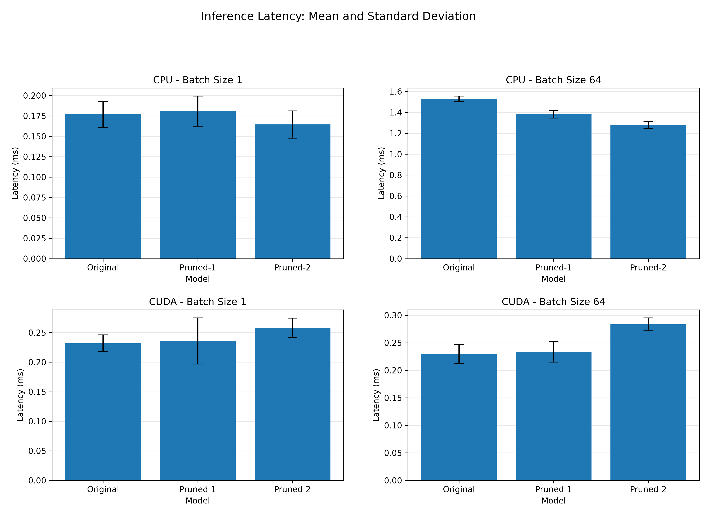
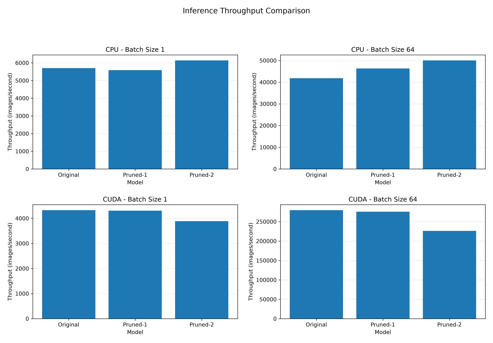
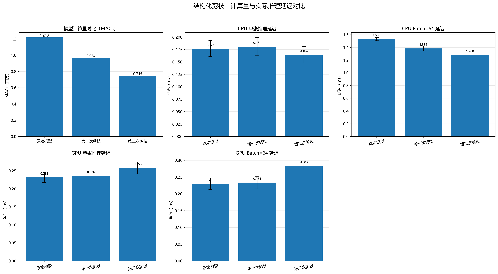
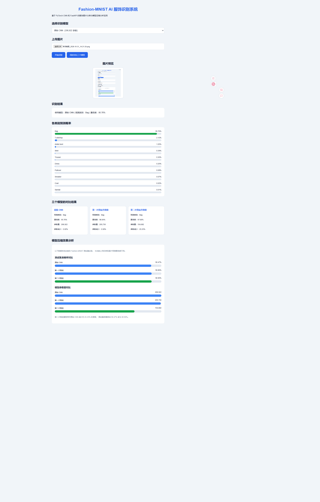

# Fashion-MNIST CNN Structured Pruning
[](https://github.com/zteyrt/fashion-mnist-compression/actions/workflows/tests.yml)
基于 PyTorch 的 Fashion-MNIST 卷积神经网络结构化剪枝与 Web 可视化项目。

本项目从 CNN 模型训练出发，通过卷积通道重要性评估、两阶段结构化剪枝和微调，研究模型压缩对分类准确率、参数量、计算量及实际推理性能的影响。

项目同时使用 **FastAPI、HTML、CSS 和 JavaScript** 构建交互式 Web 应用，支持图片上传、单模型识别、三模型切换、预测概率展示及模型压缩结果可视化。

## 1. 项目简介

本项目以 Fashion-MNIST 数据集为实验对象，构建基础 CNN 分类模型，并对卷积层进行两阶段结构化剪枝。

主要功能包括：

- 使用 PyTorch 训练 Fashion-MNIST CNN 分类模型。
- 根据卷积核权重重要性进行结构化通道剪枝。
- 通过微调恢复剪枝后的分类性能。
- 对比模型准确率、参数量、MACs 和权重文件大小。
- 测试 CPU 和 CUDA 环境下的推理延迟与吞吐量。
- 使用 FastAPI 部署模型推理接口。
- 通过 Web 页面上传图片并进行实时预测。
- 在三个 CNN 模型之间切换。
- 同时展示三个模型的预测结果及参数压缩率。
- 通过柱状图展示测试准确率与模型参数量。

## 2. 技术栈

| 技术 | 用途 |
|---|---|
| Python 3.11 | 项目开发语言 |
| PyTorch | CNN 构建、训练与模型推理 |
| Torchvision | Fashion-MNIST 数据集和图像预处理 |
| NumPy | 数值计算 |
| Matplotlib | 实验结果可视化 |
| Pandas | 实验数据整理 |
| FastAPI | REST API 服务 |
| Uvicorn | ASGI Web 服务器 |
| Pillow | 上传图片处理 |
| HTML / CSS | Web 页面结构与样式 |
| JavaScript | 图片上传、接口调用和动态图表 |
| Git / GitHub | 版本管理与项目展示 |

## 3. CNN 模型结构

### 3.1 原始 CNN

模型包含两层卷积层、ReLU 激活函数、最大池化层和两层全连接层。

输入为 `1 × 28 × 28` 的 Fashion-MNIST 灰度图片，输出为十个类别的分类得分。

| 网络层 | 原始结构 |
|---|---|
| Conv1 | 1 → 16 通道，3×3 卷积 |
| ReLU + MaxPool | 特征提取与下采样 |
| Conv2 | 16 → 32 通道，3×3 卷积 |
| ReLU + MaxPool | 特征提取与下采样 |
| Flatten | 32 × 7 × 7 = 1568 |
| FC1 | 1568 → 128 |
| FC2 | 128 → 10 |

模型原始参数量为 **206,922**。

### 3.2 支持动态通道配置

`src/model.py` 中的 `FashionCNN` 支持不同的卷积通道数：

```python
from src.model import FashionCNN

baseline = FashionCNN(16, 32)
pruned1 = FashionCNN(12, 32)
pruned2 = FashionCNN(12, 24)
```

三个模型分别对应原始 CNN、第一次剪枝模型和第二次剪枝模型。

## 4. 两阶段结构化剪枝

### 4.1 第一阶段：剪枝 Conv1

根据卷积核权重绝对值之和评估输出通道的重要性，移除重要性最低的 4 个通道。

- Conv1 输出通道：16 → 12。
- Conv2 输入通道：16 → 12。
- Conv2 输出通道保持 32。
- 剪枝后进行微调。

### 4.2 第二阶段：剪枝 Conv2

进一步对 Conv2 的输出通道进行结构化剪枝。

- Conv2 输出通道：32 → 24。
- FC1 输入特征：1568 → 1176。
- 剪枝后再次进行微调。

最终得到结构更紧凑的 CNN 模型。

### 4.3 三种模型结构对比

| 指标 | 原始 CNN | 第一次剪枝 | 第二次剪枝 |
|---|---:|---:|---:|
| Conv1 输出通道 | 16 | 12 | 12 |
| Conv2 输出通道 | 32 | 32 | 24 |
| FC1 输入特征 | 1568 | 1568 | 1176 |
| 参数量 | 206,922 | 205,730 | 154,682 |

## 5. 模型压缩实验结果

### 5.1 准确率与模型规模

以下为当前实验记录中的测试集结果。

| 指标 | 原始模型 | 第一次剪枝并微调 | 第二次剪枝并微调 |
|---|---:|---:|---:|
| 测试准确率 | 90.47% | 90.86% | 90.90% |
| 参数量 | 206,922 | 205,730 | 154,682 |
| MACs | 1.2180 M | 0.9640 M | 0.7445 M |
| 权重文件大小 | 0.7930 MB | 0.7888 MB | 0.5941 MB |
| 参数量减少 | 0.00% | 0.58% | 25.25% |
| MACs 减少 | 0.00% | 20.85% | 38.88% |

说明：

- FLOPs 按每次 MAC 对应 2 FLOPs 的口径估算。
- 模型文件大小为当前实验环境下保存的权重文件大小。
- 参数量与 MACs 的减少比例均以原始模型为基准。
- 测试准确率来自 Fashion-MNIST 测试集评估，而不是单张图片的预测置信度。

### 5.2 实验结果分析

第二次剪枝模型相较原始模型：

- 参数量减少约 **25.25%**。
- MACs 减少约 **38.88%**。
- 权重文件大小减少约 **25.08%**。
- 测试准确率由 90.47% 变为 90.90%，提高 **0.43 个百分点**。

当前实验表明，在本次实验配置下，结构化剪枝能够减少模型规模和理论计算量，同时维持分类性能。

上述结果不代表剪枝在所有数据集、模型和硬件环境下都能提高准确率或推理速度。

## 6. CPU / CUDA 推理性能分析

本项目通过重复测量评估不同模型的推理性能。

测试包括：

- CPU 与 CUDA 环境。
- Batch Size 为 1 和 64。
- 每组配置重复测量 20 次。
- 统计平均延迟、延迟标准差和平均吞吐量。

### 6.1 推理延迟对比

下图展示不同模型在 CPU 和 CUDA 环境下的推理延迟，误差线表示重复测量的标准差。



### 6.2 推理吞吐量对比

吞吐量表示单位时间内处理的图像数量，单位为 images/second。



### 6.3 计算量与推理延迟

将 MACs 与实际测量的推理延迟结合分析，可以观察理论计算量和硬件运行效率之间的差异。



### 6.4 性能分析结论

根据当前实验记录：

- 第二次剪枝显著减少了模型参数量和理论计算量。
- CPU 环境下，第二次剪枝模型在当前测试条件下具有更低的推理延迟。
- CUDA 环境下，剪枝模型的推理延迟有所增加。
- 不同 Batch Size 下，模型延迟与吞吐量存在差异。
- 参数减少和 MACs 降低不必然带来实际推理加速。

以上结论仅适用于本次使用的硬件、软件环境和测试配置。

## 7. FastAPI 模型推理服务

项目提供基于 FastAPI 的模型推理服务。

后端启动时加载三个 CNN 模型，并根据前端请求选择对应模型。

### 7.1 API 接口

| 请求方法 | 接口 | 功能 |
|---|---|---|
| GET | `/` | 查看 API 基本信息 |
| GET | `/health` | 服务健康检查 |
| GET | `/models` | 查看支持的模型列表 |
| POST | `/predict` | 使用指定模型预测图片 |
| POST | `/compare` | 使用三个模型同时预测图片 |
| GET | `/web` | 打开 Web 应用 |
| GET | `/docs` | 查看 Swagger API 文档 |

### 7.2 单模型预测接口

`POST /predict`

请求使用 `multipart/form-data`：

- `file`：需要识别的 PNG 或 JPG 图片。
- `model_name`：模型名称，可选 `baseline`、`pruned1`、`pruned2`，默认 `baseline`。

返回内容包括：

- 上传文件名。
- 使用的模型名称。
- 预测类别。
- 分类置信度。
- 运行设备。
- 十个类别的预测概率。

### 7.3 三模型对比接口

`POST /compare`

上传一张图片，接口依次使用三个已经加载的 CNN 模型进行推理。

返回每个模型的：

- 模型名称。
- 预测类别。
- 预测置信度。
- 参数数量。
- 十个类别的预测概率。

该接口是 Web 三模型同时对比功能的数据来源。

## 8. Web 可视化应用

项目提供基于 HTML、CSS 和 JavaScript 开发的交互式 Web 页面。

### 8.1 功能介绍

**图片上传与预览**

支持上传 PNG 和 JPG 图片，上传后可直接在页面预览。

**单模型识别**

用户可在以下模型中选择：

- 原始 CNN。
- 第一次剪枝并微调模型。
- 第二次剪枝并微调模型。

点击“开始识别”后，页面显示预测类别与置信度。

**十类别预测概率可视化**

对 Fashion-MNIST 的十个类别按预测概率降序排列，使用柱状图展示概率分布，并高亮最高概率类别。

**三模型同时对比**

点击“同时对比三个模型”，一次请求即可得到三种模型的预测结果。

页面展示：

- 预测类别。
- 预测置信度。
- 模型参数量。
- 相对原始模型的参数减少比例。

**模型压缩效果分析**

页面根据实验记录展示三个模型的：

- 测试集分类准确率。
- 模型参数数量。

这些指标与当前上传图片的预测置信度是不同的数据。

### 8.2 Web 页面截图

建议将当前 Web 页面截图保存为 `assets/web_dashboard.png`。

保存并提交截图后，可取消下面这一行的注释，展示完整页面：



### 8.3 Web 运行效果示例

使用 Fashion-MNIST 测试集中的短靴图片进行预测：

| 模型 | 预测类别 | 单图置信度 | 参数量 |
|---|---|---:|---:|
| 原始 CNN | Ankle boot | 98.38% | 206,922 |
| 第一次剪枝 | Ankle boot | 96.68% | 205,730 |
| 第二次剪枝 | Ankle boot | 99.48% | 154,682 |

这些结果仅为同一张示例图片的预测结果，不代表模型整体分类准确率。

## 9. 项目目录结构

以下展示项目的主要文件和目录，具体以仓库实际内容为准。

```text
fashion-mnist-compression/
├── assets/
│   ├── fashion_mnist_sample.png
│   ├── repeat_latency.png
│   ├── repeat_throughput.png
│   └── compute_latency_comparison.png
│
├── checkpoints/
├── configs/
├── data/
├── notebooks/
│
├── results/
│   ├── benchmark_inference_repeat.csv
│   └── model_compute.csv
│
├── src/
│   ├── model.py
│   ├── train.py
│   ├── evaluate.py
│   ├── prune.py
│   ├── prune_conv2.py
│   ├── inference.py
│   ├── inference_api.py
│   ├── save_sample.py
│   ├── check_model_weights.py
│   ├── test_load_three_models.py
│   ├── benchmark_inference.py
│   ├── benchmark_inference_repeat.py
│   ├── measure_compute.py
│   └── plot_repeat_benchmark.py
│
├── web/
│   ├── index.html
│   ├── style.css
│   └── script.js
│
├── tests/
├── .gitignore
├── requirements.txt
└── README.md
```

主要目录说明：

- `src/`：CNN 模型、训练、剪枝、评估、推理接口及性能分析代码。
- `web/`：前端 HTML、CSS 和 JavaScript。
- `assets/`：实验图表与演示图片。
- `results/`：实验 CSV 数据及结果文件。
- `data/`：Fashion-MNIST 数据集。
- `checkpoints/`：训练过程中保存的检查点。
- `configs/`：实验配置。
- `notebooks/`：实验笔记本。
- `tests/`：测试代码。

## 10. 环境安装

推荐使用 Python 3.11。

首先克隆项目：

```bash
git clone https://github.com/zteyrt/fashion-mnist-compression.git
cd fashion-mnist-compression
```

安装项目依赖：

```bash
python -m pip install -r requirements.txt
```

使用 NVIDIA GPU 时，请确保 PyTorch、Torchvision 与当前显卡驱动及 CUDA 环境兼容。

建议参考 [PyTorch 官方安装说明](https://pytorch.org/get-started/locally/) 选择适合本机的版本。


## 11. 模型权重下载与使用

本项目已在 GitHub Releases 发布三个训练好的 CNN 模型权重。

**下载地址：**

[Download pretrained models — v1.0.0](https://github.com/zteyrt/fashion-mnist-compression/releases/tag/v1.0.0)

### 11.1 模型权重列表

| 模型 | 权重文件 | 测试准确率 |
|---|---|---:|
| 原始 CNN | `fashion_cnn_baseline.pth` | 90.47% |
| 第一次剪枝并微调 | `fashion_cnn_pruned_12ch_finetuned.pth` | 90.86% |
| 第二次剪枝并微调 | `fashion_cnn_pruned_12_24ch_finetuned.pth` | 90.90% |

### 11.2 下载方法

1. 打开上方 GitHub Releases 链接。
2. 在 **Assets** 区域下载三个 `.pth` 文件。
3. 将三个权重文件放在项目根目录。

目录结构如下：

```text
fashion-mnist-compression/
├── fashion_cnn_baseline.pth
├── fashion_cnn_pruned_12ch_finetuned.pth
├── fashion_cnn_pruned_12_24ch_finetuned.pth
├── src/
├── web/
├── requirements.txt
└── README.md
```

### 11.3 模型加载验证

下载权重并放好后，在项目根目录执行：

```bash
python -m src.test_load_three_models
```

如果三个模型都显示加载成功，并且推理输出形状均为 `torch.Size([1, 10])`，说明权重文件可以正常使用。

之后可按照第 12 节的说明启动 Web 应用。

**注意：** 模型权重通过 GitHub Releases 提供，不直接保存在 Git 仓库中。


## 12. 启动 Web 应用

确保三个模型权重文件已经放置在项目根目录。

在项目根目录运行：

```bash
python -m uvicorn src.inference_api:app --reload
```

服务器默认运行地址：

```text
http://127.0.0.1:8000
```

打开 Web 页面：

```text
http://127.0.0.1:8000/web
```

查看 API 文档：

```text
http://127.0.0.1:8000/docs
```

查看模型列表：

```text
http://127.0.0.1:8000/models
```

### 使用说明

1. 打开 `/web` 页面。
2. 选择原始 CNN 或剪枝模型。
3. 上传一张 PNG 或 JPG 图片。
4. 点击“开始识别”查看预测结果和概率柱状图。
5. 点击“同时对比三个模型”查看三种模型的预测结果。
6. 向下滚动查看模型准确率和参数量分析图。

图片会转换为 `28 × 28` 灰度图进行预测。

需要注意，模型使用 Fashion-MNIST 数据训练，主要适用于与其数据分布相近的服饰图片。普通照片、复杂背景或不属于训练类别的图片可能产生不可靠的高置信度预测。

## 13. 运行实验脚本

在项目根目录执行。

### 13.1 训练基础模型

```bash
python src/train.py
```

### 13.2 评估基础模型

```bash
python src/evaluate.py
```

### 13.3 运行推理性能测试

```bash
python src/benchmark_inference_repeat.py
```

### 13.4 统计模型计算量

```bash
python src/measure_compute.py
```

### 13.5 生成重复测量图表

```bash
python src/plot_repeat_benchmark.py
```

### 13.6 检查三个模型的权重结构

```bash
python src/check_model_weights.py
```

### 13.7 测试三个模型的加载与推理

```bash
python -m src.test_load_three_models
```

注意：剪枝和微调脚本需要按照其权重依赖及执行顺序运行。运行前应确认相应的模型权重已经生成，并检查脚本路径配置。

## 14. 项目总结

本项目实现了从 CNN 模型训练到结构化剪枝、模型微调、性能评估和 Web 推理展示的完整实验流程。

主要成果包括：

- 完成 Fashion-MNIST CNN 十分类任务。
- 实现两阶段卷积通道结构化剪枝。
- 第二次剪枝后模型参数量减少约 25.25%。
- MACs 减少约 38.88%。
- 测试准确率达到 90.90%。
- 完成 CPU 与 CUDA 推理性能测试。
- 使用 FastAPI 提供单模型预测和三模型对比接口。
- 使用 JavaScript 实现图片预览、动态概率图和模型压缩数据展示。

实验表明，模型参数量和理论计算量的减少不必然带来相同比例的运行时间改善。因此，模型压缩需要结合实际硬件、Batch Size、准确率和推理性能综合评估。

## 15. 后续改进计划

- 进一步完善 CPU/GPU 推理性能可视化。
- 为 Web 应用增加动态推理耗时展示。
- 比较 FP32、FP16 等不同推理精度。
- 探索不同通道重要性评价指标。
- 研究不同剪枝比例对模型准确率的影响。
- 尝试 ONNX 等模型导出与部署方案。
- 完善自动化测试、实验复现流程和模型权重分发方式。
